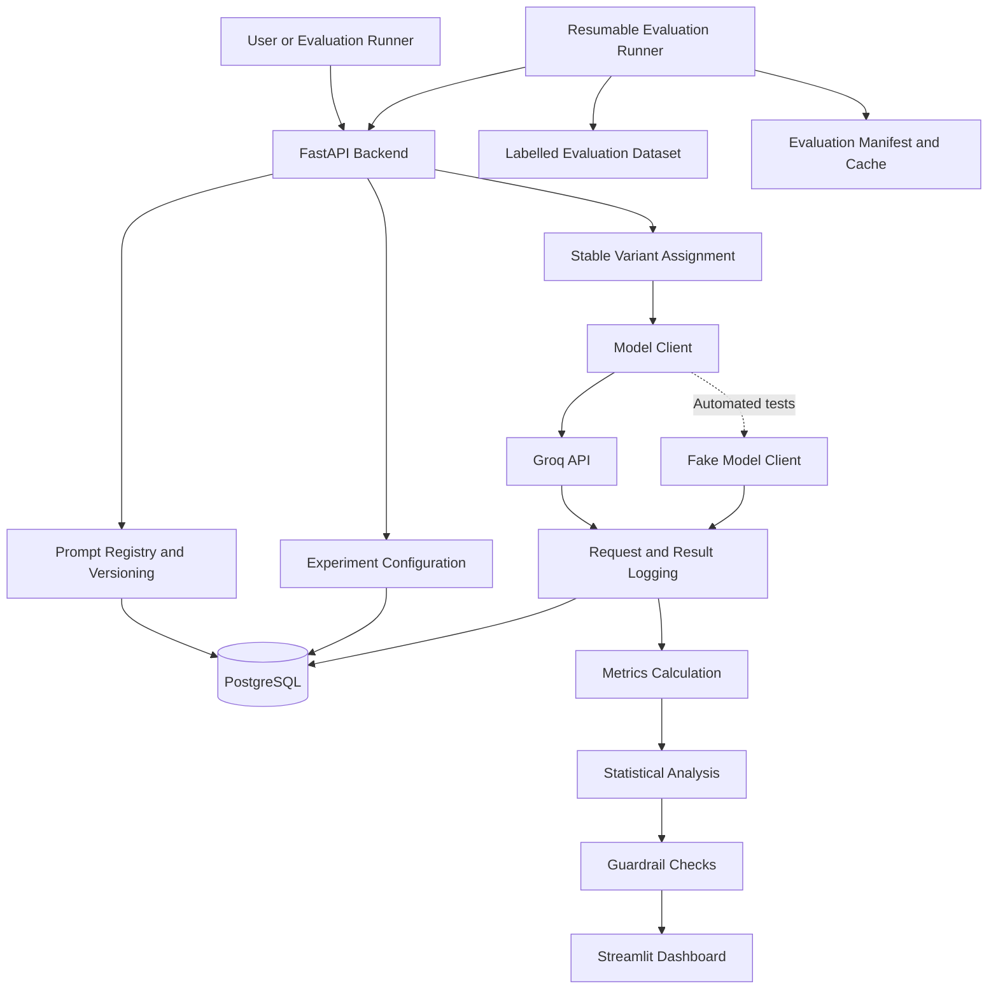

# System Architecture — Prompt Versioning and A/B Testing Platform

## 1. Project Overview

The Prompt Versioning and A/B Testing Platform is designed to help developers manage different versions of AI prompts and compare their performance using a structured evaluation process.

Instead of changing a prompt without tracking its history, the platform will store prompt versions, record experiment configurations, collect evaluation results, and help users decide whether a new prompt performs better than the current version.

The project will use Groq to access a language model, FastAPI to provide backend APIs, PostgreSQL to store records, and Streamlit to display results.

**Project status:** The initial repository and development environment have been prepared. The application features described below are planned and will be implemented and tested in stages.

## 2. Main Components

### 2.1 Prompt Registry and Version Management

The prompt registry will store prompts and their versions.

Planned capabilities:

- Create and save prompts.
- Maintain separate versions of each prompt.
- Record version numbers and creation details.
- Compare prompt versions.
- Roll back to a previous version.
- Store reusable prompt templates.
- Maintain an audit history of important changes.

This will help track which prompt version was used in an experiment and make previous versions easier to recover.

### 2.2 Experiment Management

The experiment module will manage comparisons between a control prompt and a treatment prompt.

Each experiment should record:

- Experiment identifier and name.
- Control and treatment prompt versions.
- Model configuration.
- Traffic allocation settings.
- Primary metric and guardrail metrics.
- Planned sample size and analysis settings.
- Experiment status and results.

The statistical analysis plan should be defined before examining the final results. This helps reduce the risk of making a decision based on repeated, unplanned checks.

### 2.3 Stable Traffic Assignment

The platform will use deterministic hash-based assignment to allocate eligible users or test subjects to experiment variants.

The same assignment key should receive the same variant while the experiment configuration remains unchanged.

This helps make assignments reproducible and reduces accidental switching between variants.

The implementation will also check that the selected allocation and assignment key are appropriate for the experiment.

### 2.4 FastAPI Backend

FastAPI will expose the application's backend endpoints.

The planned completion endpoint is:

`POST /v1/completions`

It will accept a request containing the relevant prompt or experiment information, select the configured prompt version, call the language-model client, and return a structured response.

The backend will also support prompt management, experiment configuration, result retrieval, and related operations as these features are implemented.

Request validation, clear error responses, and appropriate logging will be included.

### 2.5 Groq Model Client

The model-client layer will connect the application to Groq.

The API key will be loaded from an environment variable and must not be committed to GitHub.

The model name will be selected only after checking current Groq documentation and availability.

The client will be designed so that a fake or mock client can be injected during automated tests. This will allow most tests to run without making real API calls or spending API credits.

Actual token usage, latency, errors, and cost will be recorded only when reliable information is available. Cost calculations will use verified pricing rather than assumed values.

### 2.6 Database and Logging

PostgreSQL will store the application's persistent records.

Planned records include:

- Prompts and prompt versions.
- Templates and version history.
- Experiments and their configurations.
- Requests and model responses, where appropriate.
- Evaluation results and metrics.
- Audit events and experiment status.

SQLAlchemy will be used for database interaction, with database configuration managed through environment variables.

The design will avoid storing API secrets and will limit unnecessary sensitive information in logs.

### 2.7 Evaluation Dataset and Runner

A labelled customer-support dataset will be prepared for prompt evaluation.

The dataset will be separated into development examples, few-shot examples where needed, and held-out evaluation examples.

The held-out examples must not be repeatedly used to tune prompts. This separation helps reduce data leakage and gives a more reliable estimate of performance on unseen examples.

An evaluation runner will execute prompt evaluations and save results. It is planned to support:

- A small smoke test of approximately 20 examples.
- A larger pilot evaluation.
- Saving intermediate progress.
- Caching completed evaluations where safe and appropriate.
- A manifest describing the dataset, prompt versions, model configuration, and evaluation settings.
- Resuming interrupted evaluation runs.

Evaluation results must identify the prompt version and configuration used to produce them.

### 2.8 Metrics and Statistical Analysis

The platform will report suitable performance and operational metrics.

Planned metrics include:

- Accuracy as the primary metric for the initial labelled classification evaluation.
- Macro-F1 to help assess performance across classes.
- Confusion matrix.
- Per-variant latency.
- Error rate.
- Token usage when available from the model response or provider metadata.
- Cost only when usage and applicable pricing can be verified.

#### Independent live-style A/B comparison

For an independent comparison of control and treatment outcomes, the planned analysis includes:

- Fisher's exact test for a suitable binary outcome comparison.
- A significance level of 0.05.
- Wilson confidence intervals for each variant's proportion.
- A Newcombe-Wilson confidence interval for the difference between proportions.
- A defensible sample-size and minimum detectable effect (MDE) calculation.
- Predefined stopping and analysis rules to reduce the risk of repeatedly checking results and stopping when they appear favourable.

The analysis method must match the actual experiment design and outcome type. A statistically significant result alone does not establish that a prompt is practically better.

#### Paired offline comparison

When both prompts are evaluated on the same labelled examples, the observations are paired. The planned comparison will use the exact McNemar test for suitable paired binary correctness outcomes.

The paired offline evaluation will be reported separately from an independent live-style A/B experiment. These designs should not be treated as interchangeable.

### 2.9 Guardrails

The platform will check whether a treatment prompt introduces unacceptable regressions.

Potential guardrails include:

- Increased request failure rate.
- Excessive latency.
- Reduced evaluation quality.
- Unexpected or invalid model outputs.
- Increased usage or cost when reliable measurements are available.

The project will define suitable thresholds before using these guardrails to make an experiment decision.

### 2.10 Streamlit Dashboard

Streamlit will provide a simple user interface for viewing and exploring results.

Planned dashboard sections include:

- Prompt versions and history.
- Experiment configuration and status.
- Control-versus-treatment metric comparisons.
- Confidence intervals and statistical test results.
- Latency and error summaries.
- Evaluation run history.
- Relevant guardrail results.

The dashboard will display the evidence used for a decision rather than presenting a winner without context.

## 3. High-Level Architecture

The intended flow is:

1. A user creates or selects prompt versions.
2. An experiment is configured with its variants, metrics, and analysis plan.
3. A request reaches the FastAPI backend.
4. The assignment logic selects the appropriate experiment variant.
5. The model-client layer calls Groq or an injected fake client during testing.
6. The application records the relevant request, response, and measurements.
7. The evaluation and metrics modules calculate performance.
8. The statistical analysis module compares the results using a method appropriate to the experiment design.
9. PostgreSQL stores the records.
10. Streamlit presents the results and supporting evidence.

## 4. Architecture Diagram

The following diagram describes the intended architecture, not a completed implementation.

## 5. Technology Stack

| Component | Planned technology | Purpose |
|---|---|---|
| Programming language | Python 3.11 | Application logic |
| Backend API | FastAPI | HTTP endpoints |
| Language model access | Groq | Generate model responses |
| Database | PostgreSQL | Persistent application records |
| Database access | SQLAlchemy and psycopg | Database operations |
| Dashboard | Streamlit | Visualize experiments and metrics |
| Data processing | pandas and scikit-learn | Dataset preparation and evaluation |
| Statistical analysis | SciPy and statsmodels | Statistical tests and confidence intervals |
| Configuration | Pydantic Settings and environment variables | Application settings |
| Testing | pytest | Automated tests |
| Version control | Git and GitHub | Code history and collaboration |
| Containerization | Docker and Docker Compose | Later-stage reproducible setup |

## 6. Testing Strategy

Testing will be added throughout development rather than postponed until the end.

Planned checks include:

- Prompt version creation and retrieval.
- Prompt rollback and audit history.
- Stable variant assignment.
- Request validation and error handling.
- Fake-client model calls.
- Metric calculations on known examples.
- Statistical calculations on controlled test data.
- Evaluation caching and resume behaviour.
- Database operations.
- API endpoint tests.
- Dashboard smoke checks where practical.

The application should first work locally. Docker and Docker Compose will be introduced after the main local workflow is functioning.

## 7. Security and Reliability

The project will follow these basic practices:

- Keep the Groq API key in an ignored `.env` file.
- Commit `.env.example` with placeholder values only.
- Never commit API keys, passwords, or database credentials.
- Validate incoming requests.
- Handle provider and database errors clearly.
- Avoid unnecessary sensitive information in logs.
- Record enough configuration information to reproduce evaluations.
- Test failure cases as well as successful requests.

## 8. Known Limitations and Future Improvements

At the current setup stage, the prompt registry, API endpoints, database integration, experiment execution, statistical analysis, evaluation runner, and dashboard have not yet been verified as working application features.

They will be implemented incrementally and updated here as they are tested.

Possible future improvements include:

- Authentication and role-based access.
- More advanced experiment allocation strategies.
- Additional outcome metrics and guardrails.
- Automated deployment and CI/CD.
- Production monitoring and stronger operational controls.

These improvements will be considered after the core project is working and tested.

## 9. Architecture Goal

The goal is to build a small, understandable, and testable platform that demonstrates prompt versioning, reproducible evaluation, controlled A/B experiments, and evidence-based comparison of language-model prompts.